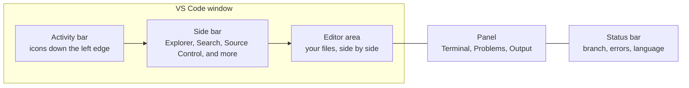
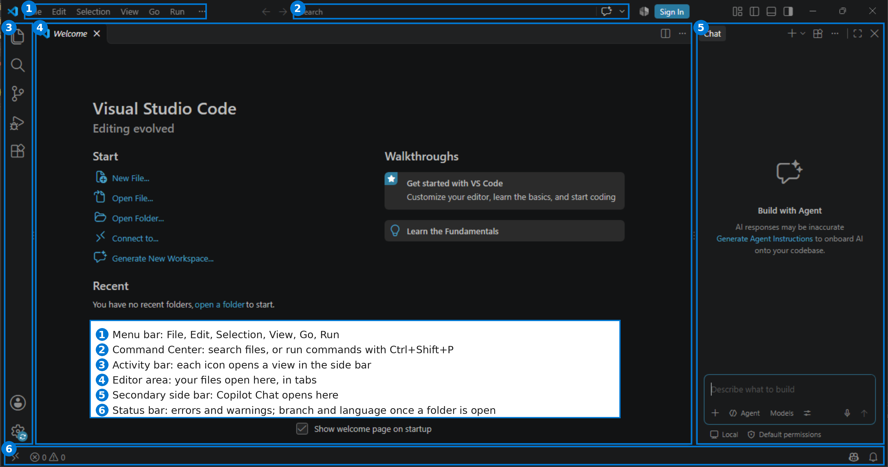
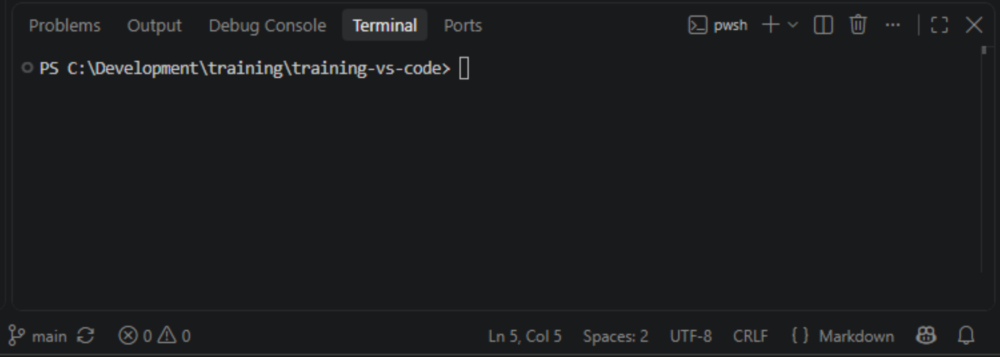

# 0. Introduction

Visual Studio Code, usually shortened to VS Code, is a free editor from Microsoft. You use it to write and change files, to run the programs those files make, and to keep your work in step with other people's through Git and GitHub. It runs on Windows, macOS, and Linux, and this course covers the Windows version. If you have ever opened a text file and thought "there must be a better way", this is the better way. Most of the tools you will use every day are a click or a keystroke away, and most of the time you will not need the mouse.

This course is a guided tour, not a reference manual. It takes you from the first launch to the work a developer does every day. You will edit with confidence, find things across a project, run and debug code, use the integrated terminal, carry a change through commit, push, and pull request, and use GitHub Copilot to help you write code and check what it writes.

> **Not a tip, a warning:** the tour is long on purpose, and you do not need to finish it in one sitting. Each chapter stands on its own, and the runner remembers the last lesson you opened, so you can pick up where you left off.

## What the course covers

The course has six parts and a summary.

1. **Getting around.** Installing, your first launch, accounts, opening folders, and the command palette.
2. **Editing code.** Typing and moving text, multiple cursors, finding and navigating, and the help the editor gives you while you type.
3. **Running and checking.** The integrated terminal, tasks, running and debugging, and testing in the editor.
4. **Source control.** The Source Control panel, branches, fetch, pull, and push, merge conflicts, history, and GitHub's accounts and pull requests.
5. **Copilot and extensions.** Setting up GitHub Copilot, suggestions and chat, checking what Copilot writes, and extensions.
6. **Working faster.** Settings, keyboard shortcuts, snippets, and what to do when things go wrong.

The course ends with a capstone that uses everything, a summary checklist, and an appendix of shortcuts and commands.

## What you need

- A computer running Windows 10 or Windows 11.
- Visual Studio Code. The setup script installs it for you, and Chapter 1 shows you how to install it by hand if you prefer.
- A GitHub account for the practice repository. If you do not have one, Chapter 2 walks you through creating it, and it is free. If your organization gives you a GitHub Enterprise address, use that address instead, and the lesson tells you where.
- Basic comfort with the terminal. You should know how to open one and type a command. Chapter 8 covers the rest.
- Patience with the practice repository. It is yours to break, and you will break it on purpose more than once.

> **Copilot and your account:** the chapters on GitHub Copilot use the free tier for practice. The free tier of GitHub Copilot is permitted for learning, and this course uses it for that purpose. Use it only with the sample code in this course, and never for DataBank work. Work at DataBank happens only through company-provided accounts, under the AI Acceptable Use Policy. Each Copilot chapter repeats this, because it matters every time.

## A tour of the window

Before you install anything, it helps to know the names of the parts of the window. The lessons use these names, and the screenshots label them the same way. The diagram shows where each part sits.

The **activity bar** is the narrow strip of icons down the left edge. Each icon opens a different view in the side bar. Explorer, Search, Source Control, Run and Debug, and Extensions are the ones you will use most.

The **side bar** shows whichever view you picked. Explorer lists the files in the folder you have open, and Source Control lists the changes you have made to them. You can hide the side bar with Ctrl+B, and you can bring it back with the same keys.

The window can also show a **secondary side bar** on the right. Copilot Chat opens there, and it stays out of your way until you need it. Your screenshots will show it, so do not be surprised by it.

The **editor area** is the large space in the middle, where your files open. You can split it to see two files side by side, and each file opens in its own tab across the top of the area.

The **panel** sits along the bottom. It holds the integrated terminal, the Problems list of errors and warnings, the Output log, and the Debug Console. You can open and close it with Ctrl+J.

The **status bar** is the thin strip at the very bottom. It shows the branch you are on, the number of errors and warnings, the language of the open file, and where your cursor is. Click an item in it and you usually get a menu for changing that thing.

## Command palette in one sentence

Almost everything in VS Code is a command, and every command can be found through the command palette. Press Ctrl+Shift+P, type a few letters of what you want, and press Enter. You will use it constantly, so it is worth learning now.

## How to read the course

Most chapters have three kinds of material, and each is marked when it starts.

- **Lessons** explain a feature and show it. Read them through once, then try the feature while the lesson is still open.
- **Checklists** ask you to do something in VS Code and tick it off when it is done. The runner keeps your ticks, so you can stop and come back.
- **Homework** asks you to change a file in the practice repository. Each homework step has a starter, and a worked solution behind a spoiler. Try the homework first. The solution is there when you are stuck, and reading it before you try teaches you much less.

Shortcuts are shown in their Windows form, such as Ctrl+Shift+P. The appendix lists the Mac equivalents, and a note appears wherever a key differs.

---
