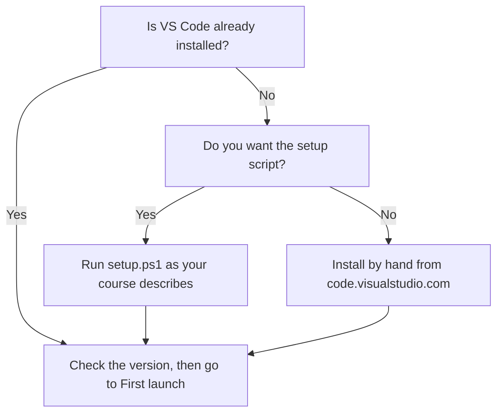

# Installing VS Code

There are two ways to get VS Code. The setup script does the work for you, and it is the usual route for this course. If you would rather do it yourself, or the script is not available to you, install by hand. Either way you end with the same program, so the rest of the course works the same.

## With the setup script

The setup script checks for Git, installs VS Code if it is missing, and opens the course folder in VS Code when it finishes. Run it the way your course tells you to. Chapter 8 explains what to do if PowerShell refuses to run a script, so if that happens, skip ahead and come back.

When the script finishes, VS Code opens on its own. Go to the First launch step, because the window you see there is the one this chapter describes.

## By hand

1. Open the VS Code download page at code.visualstudio.com and choose the Windows download.
2. Run the installer. Accept the license and keep the default install location.
3. On the Select Additional Tasks page, tick Add to PATH. It lets you type `code` in a terminal, which some later chapters use. Leave the other boxes at their defaults unless you know you want them.
4. Finish the installer. If it offers to launch VS Code, you can let it.

> **If your computer is managed:** your IT team may provide a copy of VS Code, or may limit what you can install. If they do, use their copy, and ask them before you install anything the setup script does not include.

## Check the version

Open the Help menu and choose About. Write down the version number. The course records the version its screenshots were taken with, and when your version is different, the pictures may show small differences from your screen. That is normal, and the lessons say what to look for.

---
