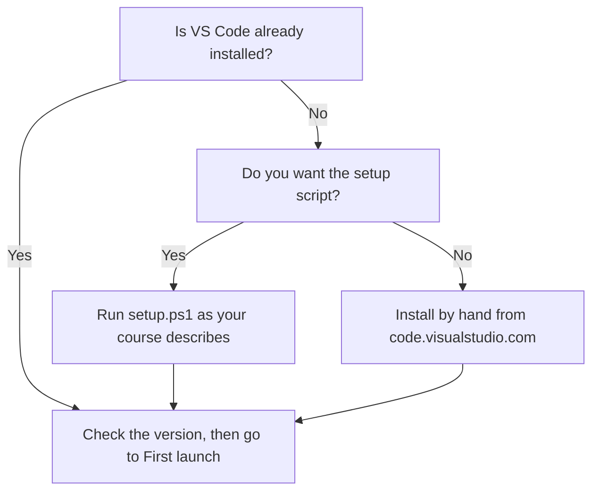

# Installing VS Code

There are two ways to get VS Code. The setup script does the work for you, and it is the usual route for this course. If you would rather do it yourself, or the script is not available to you, install by hand. Either way you end with the same program, so the rest of the course works the same.



## With the setup script

The setup script checks for Git, installs VS Code if it is missing, and opens the course folder in VS Code when it finishes. Run it the way your course tells you to. Chapter 8 explains what to do if PowerShell refuses to run a script, so if that happens, skip ahead and come back.

When the script finishes, VS Code opens on its own. Go to the First launch step, because the window you see there is the one this chapter describes.

## By hand

The quickest way is winget, which is built into Windows 10 and 11. Open PowerShell and run this command:

```
winget install Microsoft.VisualStudioCode
```

Open a new PowerShell window and run `code --version`. If it prints a version number, VS Code is installed and on your path, so go to the First launch step. If PowerShell says that code is not recognized, use the installer steps below instead.

> **Right-click menu:** winget does not add the "Open with Code" entry to the right-click menu. If you want it, use the installer steps below and tick Add "Open with Code" action, or ask your course contact for the setup script, which adds the entry for you. On Windows 11, the entry appears under Show more options.

If you would rather use the installer, follow these steps.

1. Open the VS Code download page at code.visualstudio.com and choose the Windows download.
2. Run the installer. Accept the license and keep the default install location.
3. On the Select Additional Tasks page, tick Add to PATH. It lets you type `code` in a terminal, which some later chapters use. Leave the other boxes at their defaults unless you know you want them.
4. Finish the installer. If it offers to launch VS Code, you can let it.
5. Install Git. VS Code uses Git for the source control lessons, and the course's own commands run Git in the terminal. The setup script installs Git for you, so skip this if you used the script. Otherwise, open PowerShell and run this command:

```
winget install Git.Git
```

If winget is not available, download Git for Windows from git-scm.com and use the default options. Either way, open a new PowerShell window before you use Git, so that it can find the new program.

> **If your computer is managed:** your IT team may provide a copy of VS Code, or may limit what you can install. If they do, use their copy, and ask them before you install anything the setup script does not include.

## Install PowerShell 7 (recommended)

Windows already includes Windows PowerShell, which is the version you have in the Start menu. The course uses the newer PowerShell 7 for its terminal examples, so install it too. Open PowerShell and run this command:

```
winget install Microsoft.PowerShell
```

When it finishes, open PowerShell 7 from the Start menu. Chapter 8 shows how to make it the default terminal in VS Code.

## Check the version

Open the Help menu and choose About. Write down the version number. The course records the version its screenshots were taken with, and when your version is different, the pictures may show small differences from your screen. That is normal, and the lessons say what to look for.

---

## If you cannot install software or run scripts

Some computers are managed by an employer or a school, and they do not let you install programs or run scripts. If your computer is like that, you will not be able to finish the install steps on it, and you should not try to get around the restriction. Do this instead:

- Ask the person who manages the computer to install Visual Studio Code for you. Tell them the program is Visual Studio Code from Microsoft, and that its download page is code.visualstudio.com.
- Ask whether the setup script can run. If it cannot, the by-hand steps in this chapter still apply, once VS Code is installed. The script saves time, but you do not need it.
- If the setup script is blocked, skip it and go to the First launch step. Chapter 8 explains the execution policy setting that the script's run command depends on. A managed computer may not allow that setting to change, so you may not be able to follow Chapter 8 either. If that happens, the chapter's other steps still work.

If you are not sure whether your computer is managed, try the winget command above. If it asks for a password or fails with a message about permissions, the computer is probably managed.

