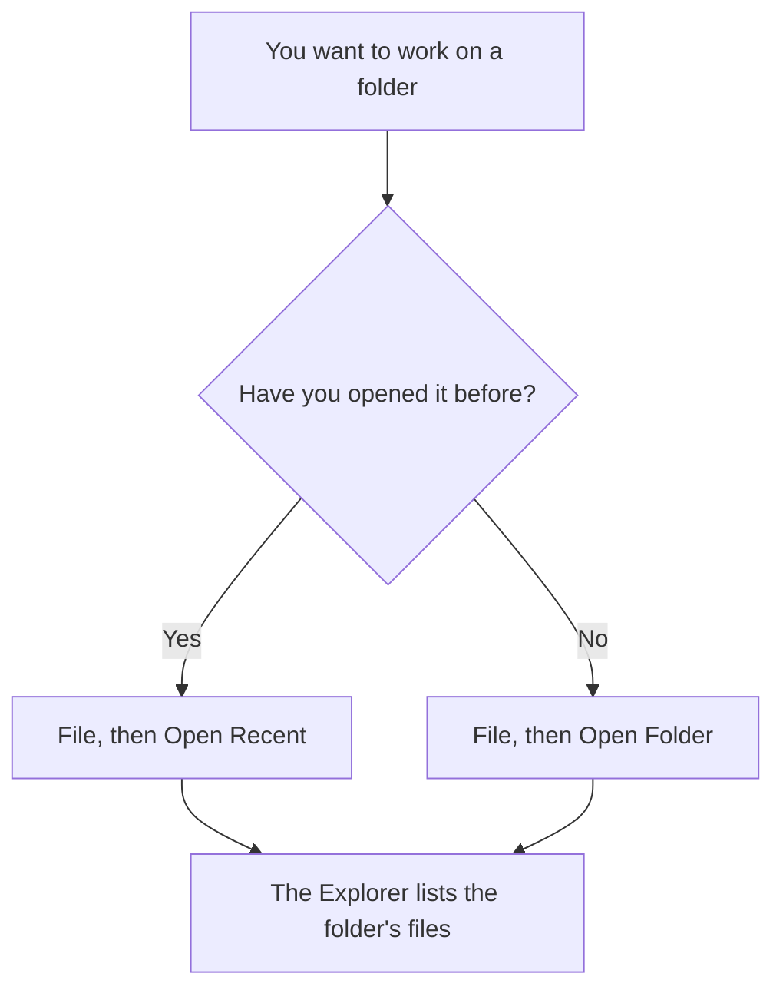

# Opening a folder

Open Folder makes a folder the project you are working on. Choose File, then Open Folder, pick the folder, and select Select Folder. VS Code opens the folder in the window, and the Explorer on the left lists what is inside it.

*Figure 3.1 - Open Folder in the File menu*

The shortcut is Ctrl+K, then Ctrl+O, pressed one after the other. You do not need to hold the keys together.

## Open Recent

VS Code remembers the folders you have opened. File, then Open Recent, lists them, so you can reopen one without finding it again. Removing a folder from the list only removes the entry. It does not delete anything on your computer.

> **Trust prompt:** the first time you open a folder, VS Code opens it in Restricted Mode. Chapter 1 explains how to turn on trust for it, and you should do that for the course folder.

---
