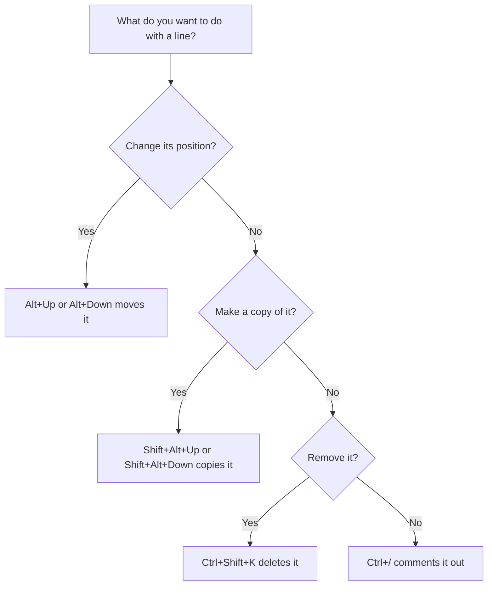

# Undo, redo, and moving lines

Every change you make can be undone. Press {{Ctrl+Z}} to undo the last change, and press it again to go back further. {{Ctrl+Y}} redoes a change you have just undone. VS Code remembers many steps, so you can go back a long way.

Moving lines is faster with the keyboard than with cut and paste. Put the cursor on a line, then press {{Alt+Up}} to move it up one line, or {{Alt+Down}} to move it down. You can select several lines first, and the whole block moves together.

Here is the top of `calculator.py` before the move. The cursor is on the `return` line, which is line 4.

```python
def add(a,b):
    return a+b


def total(numbers):
```

Press {{Alt+Down}} once. The `return` line moves below the blank line that followed it. The file still runs, because the line is still indented inside `add`.

```python
def add(a,b):

    return a+b


def total(numbers):
```

## Copying a line

To copy a line instead of moving it, hold Shift as well. {{Shift+Alt+Down}} copies the line below the cursor, and {{Shift+Alt+Up}} copies the line above. The original line stays where it was.

## Which key to use

The keys above cover most of the job, and the chart shows which one to reach for.



---
