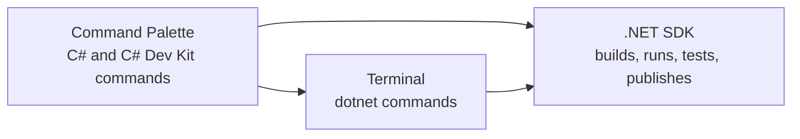

# 9. The .NET Command-Line Tools

This chapter is a walkthrough, not a feature tour. You create a .NET console project from the Command Palette, then do the same work in the terminal, one command at a time. Along the way you see which palette commands come from the C# extension, which come from C# Dev Kit, and which come from the .NET SDK itself. The terminal commands need only the SDK.

Scripts and automation call the terminal commands, not the palette, so the terminal is where the rest of this chapter spends its time. The last step is homework: a second project, published as a single file.

> **Before you start:** C# Dev Kit requires you to sign in with a Microsoft account, and the sign-in checks which license applies to that account. Use this course for learning. Work development for DataBank requires a paid, company Microsoft account, and that is the only account to use for work code.

## Before you start

The setup script installs the .NET SDK, version 10, and the C# and C# Dev Kit extensions. If you ran the setup script before this chapter existed, check these three things first.

1. In the terminal, run `dotnet --version`. It should print 10 or later. If it does not, run `winget install --id Microsoft.DotNet.SDK.10 --exact`, then open a new terminal.
2. Open the Extensions view with {{Ctrl+Shift+X}}. Check that C# and C# Dev Kit (`ms-dotnettools.csdevkit`) are installed and enabled. If one is missing, search for its ID and install it.
3. Sign in with your Microsoft account when C# Dev Kit asks you to. You do not need to sign in to install the extension, but you do need to sign in to use it. The sign-in checks which license applies to your account, and the extension does not work fully without it.

