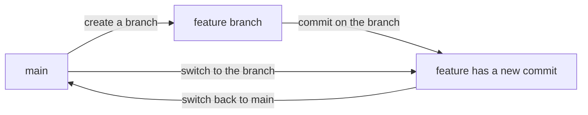

# Creating and switching branches

Each branch points to its own latest commit. When you switch branches, Git changes the files in your folder to match that commit. Commits you make on one branch do not appear on the others until you merge them, which Chapter 13 covers.


*Figure 11.6 - The branch picker, opened from the branch name in the status bar*



## Create a branch

Click the branch name in the bottom left of the status bar, which shows `main`. VS Code opens a list at the top of the window. Choose `+ Create new branch...`, and type `readme-note` as the name. VS Code creates the branch from the current commit and switches to it. The status bar now shows `readme-note`.

You can also run the command `Git: Create Branch...` from the Command Palette.

## Commit on the branch

Open `README.md` and add a line at the end. Save the file, stage it in the Source Control view, and commit it with the message `Add a note on the readme-note branch`. The commit goes on `readme-note`, not `main`.

## Switch back to main

Click the branch name in the status bar, and choose `main` in the list. The status bar now shows `main`, and the line you added is gone from `README.md`. Its commit is still on `readme-note`, and switching back brings it back.

Check the result in the terminal:

```
git branch
```

The current branch has an asterisk in front of it. After switching back to main, `main` should have the asterisk, and `readme-note` should be listed beside it.

---
