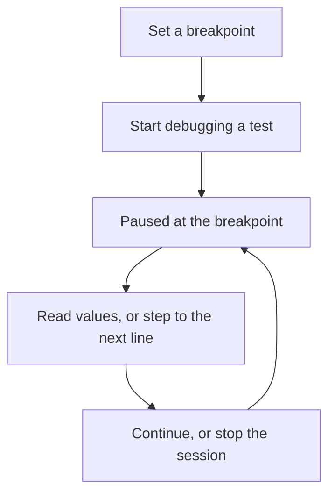

# Breakpoints and stepping

A breakpoint tells the debugger to pause when the program reaches a line. While the program is paused, you can read the values it holds, step to the next line, and continue. The loop is the same every time.

## Set a breakpoint

Open `calculator.py` and find a line inside the function `total`. Click in the gutter, the narrow strip to the left of the line numbers. A red dot appears. Click the dot again to remove it. You can also put the cursor on the line and press {{F9}}, which toggles the breakpoint.

A breakpoint can also run only when a condition is true. Right-click the gutter beside the line, choose Add Conditional Breakpoint, and type an expression, such as `a < 0`. The debugger then pauses only when that expression is true.

## Debug one test

Open the Testing view. Hover over `test_total_of_prices_is_seven`, and click the debug icon beside it. The test runs under the debugger and pauses at your breakpoint. The Debug toolbar appears at the top of the editor, and the line you stopped on is highlighted.

*Figure 11.3 - The debug toolbar at the top of the editor, with a paused line*

> **Nothing stopped?** Check that the breakpoint is on a line that the test actually runs. A breakpoint in a function the test never calls is never reached.

## Move through the code

These keys work while the program is paused:

- {{F10}} steps over: it runs the current line, and pauses on the next one.
- {{F11}} steps into: if the current line calls a function, it pauses on the first line inside that function.
- {{Shift+F11}} steps out: it runs until the current function returns, and pauses in the caller.
- {{F5}} continues to the next breakpoint, or to the end of the program.
- {{Shift+F5}} stops the session.
- {{Ctrl+Shift+F5}} restarts it.

## Read the values

While the program is paused, the Run and Debug view shows four panels:

- **Variables** lists the values in scope, and updates as you step.
- **Watch** shows expressions you choose. Click the plus sign, and type a name such as `a`.
- **Call Stack** shows the chain of calls that led to the current line.
- **Debug Console** lets you type an expression and see its value. Press {{Ctrl+Shift+Y}} to open it.

*Figure 11.4 - The Variables panel with values while paused*

## Try it

Start the debug session from the Testing view. Press {{F10}} three or four times, and watch the values in the Variables panel change. Add `a` to the Watch panel. Press {{F5}} to let the test finish. The failing test appears in the Testing view, and its message appears in the editor at the line that failed.
