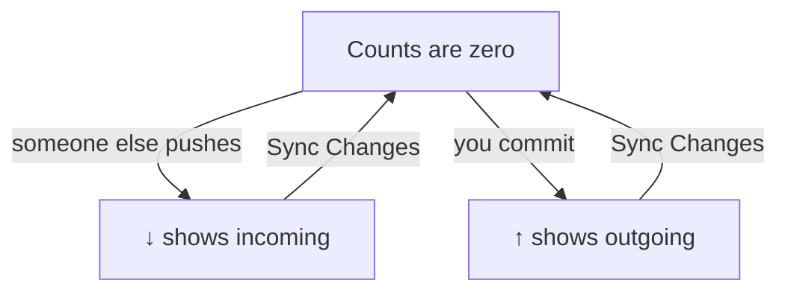

# Sync and the status bar counts

The status bar at the bottom left shows how your branch compares with its remote branch. Two arrows with numbers show the commits that are waiting in each direction:

- **↑** with a number means that many commits on your computer are not on the remote yet.
- **↓** with a number means that many commits on the remote are not on your computer yet.


*Figure 12.3 - The status bar with the outgoing count*

Read `↑2 ↓1` as two outgoing commits and one incoming commit. When both counts are zero, your branch matches the remote, and the indicator shows nothing to sync.



Sync Changes is the button that does both steps. It pulls the incoming commits, then pushes your outgoing commits. Click the counts in the status bar, or find Sync Changes in the Source Control view.


*Figure 12.4 - The Sync Changes button in the Source Control view*

By default, the pull part of Sync merges the remote's commits into yours. Turn on the setting `git.rebaseWhenSync` and Sync rebases instead, which replays your commits on top of the remote's. The setting is called "Git: Rebase When Sync" in the Settings editor, and it is off by default. You will try it in the homework at the end of this chapter.

## Commit and sync together

Most of the time, you want to push or sync right after you commit. The commit button has a dropdown arrow beside it, and the menu it opens does both in one step:


*Figure 12.5 - The commit dropdown with Commit & Push and Commit & Sync*

- **Commit & Push** commits, then pushes. Use it when your branch has no incoming commits to pull.
- **Commit & Sync** commits, then runs Sync Changes. Use it when you are not sure whether the remote has new commits, because Sync pulls first and only pushes if the pull is clean.

Commit alone is still useful when you want several commits before you push, or when you want to check the commit before it leaves your computer. The menu also lists Commit (Amend), which changes the last commit, and Commit & Create Pull Request, which Chapter 15 covers.

Sync stops when a pull hits a conflict, and it does not go on to push. The conflict has to be resolved first, which Chapter 13 covers.

> **Counts are as of the last fetch.** VS Code only knows what is on the remote as of its last fetch. Fetch first when you want an accurate count.

Check the result in the terminal:

```
git status -sb
```

The branch line shows the same counts as the status bar, in words.

---
