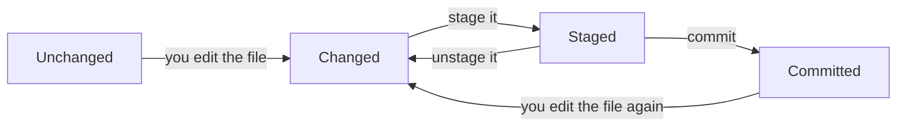

# Diff, staging, and unstaging

Git tracks each change in three stages:

A change starts as **changed** when you edit a file. **Staging** a change adds it to the next commit. Nothing is committed yet, so you can still unstage it. **Committing** saves the staged changes to the repository's history.

## Look at a change

Open `README.md` in the practice folder, and add a line at the end. Any text will do. Save the file. The Source Control view now shows `README.md` with an M beside it.

Click `README.md` in the view. VS Code opens the diff view, which has the old version on the left and the new version on the right.

*Figure 12.2 - The diff view for README.md, with the added line highlighted*

Added lines are green, and removed lines are red. The editor also shows an inline marker in the gutter beside each changed line. Click a marker to see the change and undo it, if you need to.

## Stage the change

Hover over `README.md` in the Source Control view, and click the plus sign. The file moves from Changes to Staged Changes. That is staging. Click the minus sign beside the file in Staged Changes to unstage it. Stage the file again before you go on.

Stage only `README.md`. Leave `prices.py`, `report.py`, and the other changes unstaged. The commit in the next lesson should contain only your README change.
