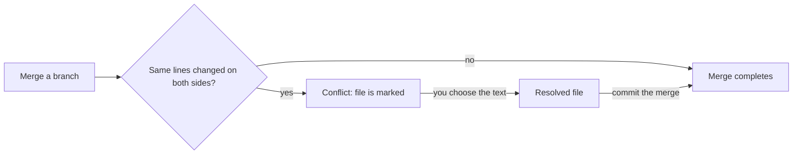

# 13. Merge Conflicts

A merge brings another branch's commits into the one you are on. Most merges go through without any help from you. A conflict happens when both branches changed the same lines, and Git cannot tell which version you want. It stops the merge, marks the file, and waits for you to decide.

You start by creating a conflict on purpose in the practice repository's Python file. The lessons after it explain how VS Code marks the conflict, how to resolve it in the editor and in the Merge Editor, and how to commit the result. You resolve the conflict in the fifth lesson.

Conflicts are normal. Teams with two people editing the same file hit them every week. Resolving one is a small editing job once you know what the markers mean.

> **Work repositories have a different rule.** You learn merges on the practice repository, where you can merge into `main` yourself. Our work repositories block direct commits and merges to main. Every change goes through a pull request, and a codeowner must approve it before it can merge. Chapter 15 covers pull requests.

---
