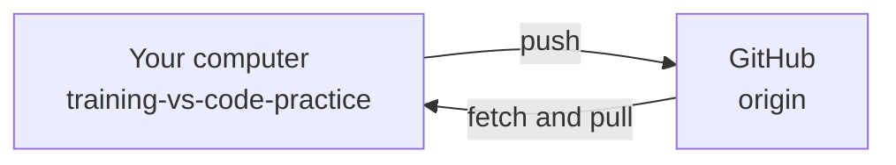

# Remotes

A remote is another copy of the repository, somewhere else. For your practice repository, the remote is your copy on GitHub. Git calls it `origin` by default, because that is the name the clone gave it in Chapter 3.



Check the remote in the terminal, in your practice folder:

```
git remote -v
```

It prints two lines, one for fetching and one for pushing, both with your copy's address.

Each branch can also be linked to a branch on the remote, called its upstream. For `main` in your practice repository, the upstream is `origin/main`. Git writes that link when you clone. Check it with:

```
git status -sb
```

The first line shows `## main...origin/main`, which means your local `main` tracks the remote's `main`. Chapter 12's commit is not on GitHub yet, so the first line may also show `[ahead 1]`.

---
