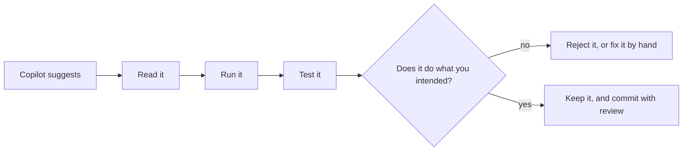

# The review loop

Use the same loop for every suggestion, from the smallest to the largest. This lesson walks through it on the leap-year example from the last lesson.



## Step 1: read it

Read `return year % 4 == 0`, and ask what the line claims. It says a year is a leap year when it is divisible by 4. Does that match what you know? Partly. Leap years are divisible by 4, but not every year divisible by 4 is a leap year.

## Step 2: run it

Run the function with years whose answers you know:

```python
print(is_leap_year(2024))
print(is_leap_year(1900))
print(is_leap_year(2000))
```

The expected output is True, False, and True. The function prints True for 1900, which is the first sign of the bug.

## Step 3: test it

Write a check yourself, using years you chose, not years Copilot chose:

```python
assert is_leap_year(1900) is False
assert is_leap_year(2000) is True
```

Run it. The first assert fails. A failing test that points at a real bug is the result you want, because it tells you exactly what to fix.

## Step 4: decide

Fix the function by hand:

```python
def is_leap_year(year):
    if year % 400 == 0:
        return True
    if year % 100 == 0:
        return False
    return year % 4 == 0
```

Run the checks again, and they pass. Keep the fix and the tests together in the commit, so the next reviewer can see what was checked.

> **Test with your own examples.** A test Copilot wrote can agree with the suggestion. Write at least one check yourself.

