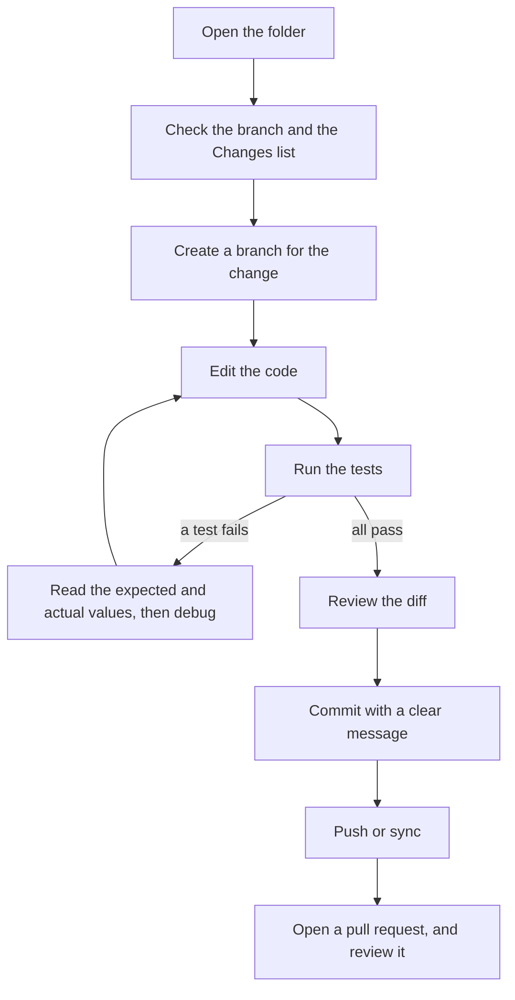

# 24. Summary: A Working Checklist

This chapter is the course in one page. It is a checklist for a clean day in the editor: open, check the branch, edit, test, commit, push, and review. Use it the first few times with the list in front of you, and you will stop needing it.

---
