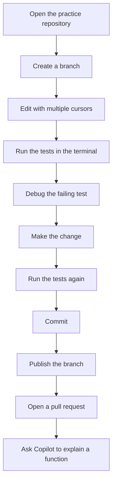

# 24. Capstone: Change, Test, Review

The calculator project has a red test. It has been red for a week, and everyone who walks past it assumes somebody else is already on it. That is how red tests survive: each person is sure the problem belongs to someone else.

This time it is your problem. You will find out who is wrong, fix it properly, and leave a trail that a reviewer can follow without asking you a single question. The story runs through every step of this chapter, and the steps are the same ones you will use on real work: open the repository, branch, edit, test, debug, commit, publish, and open a pull request.

> **The free tier of GitHub Copilot is permitted for learning, and this course uses it for that purpose.** Use it only with the sample code in this course, and never for DataBank work. DataBank work happens only through company-provided accounts, under the AI Acceptable Use Policy. Work use goes through the company-approved account only.

---
